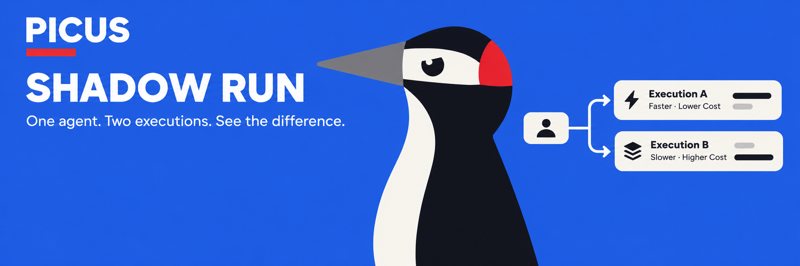

<div align="center">
  

  # PICUS
  ### Find the better route before execution.
  **AI-powered financial routing for autonomous agents.**

  [Website](site/index.html) · [Architecture](docs/architecture.md) · [Roadmap](docs/roadmap.md) · [Token utility](docs/token-utility.md) · [X / @picus_rbh](https://x.com/picus_rbh)
</div>



## What is PICUS?

PICUS is building a financial execution layer for autonomous AI agents. An agent expresses an intent; PICUS compares eligible execution routes and estimates the all-in result before capital moves.

The core mechanism is **Shadow Run**: candidate routes are simulated against the same intent and compared on execution price, gas / venue costs, slippage, liquidity constraints, latency, and route validity. The goal is not merely the lowest quoted fee — it is the **lowest valid all-in execution cost** under the user's constraints.

## How Shadow Run works

1. **Intent** — an agent submits a financial action and constraints.
2. **Discover** — PICUS collects eligible venues / routes and normalizes their quotes.
3. **Shadow Run** — candidate paths are simulated without broadcasting the real transaction.
4. **Compare** — estimated output, fees, gas, slippage, liquidity and failure conditions are evaluated.
5. **Recommend** — PICUS returns the best eligible route, or no route if evidence is insufficient.

> **Status:** the repository contains a product prototype, simulated examples and design documentation. Real routing requires live venue integrations, quote sources and transaction simulation. Example savings are not production performance claims.

## $PICUS

**Official contract**

```text
0x81f3ad4882233fcaff4e4dfbe570ac1c96f2b7b3
```

The planned utility model is holding-based: eligible $PICUS holders can receive preferential pricing on selected PICUS routing / optimization services. Holding $PICUS does **not** reduce blockchain gas, venue fees, or unrelated third-party charges.

Always verify the contract from official PICUS channels before interacting with a token. See [token utility](docs/token-utility.md) and [contract metadata](contracts/README.md).

## Repository map

| Path | Contents |
| --- | --- |
| [`site/`](site/) | Multi-page PICUS website with wallet connection and contract display |
| [`brand/`](brand/) | PICUS mascot, banner and article artwork |
| [`docs/`](docs/) | Architecture, roadmap, product specification and token utility |
| [`examples/`](examples/) | Offline route-comparison demo using synthetic data |
| [`contracts/`](contracts/) | Published contract metadata |
| [`config/`](config/) | Machine-readable public project configuration |
| [`.github/`](.github/) | Issue and pull-request templates |

## Run the website

```bash
cd site
python3 -m http.server 8000
# open http://localhost:8000
```

The wallet button requests account access from an injected EVM wallet. The static demo does not request token approvals or execute financial transactions.

## Run the offline Shadow Run example

```bash
python3 examples/compare_routes.py examples/sample-routes.json
```

The example uses synthetic quotes and makes no network, wallet or exchange calls.

## Official links

- X: https://x.com/picus_rbh
- GitHub: https://github.com/0xGarryLi/Picus_Rbh
- Contract: `0x81f3ad4882233fcaff4e4dfbe570ac1c96f2b7b3`
- Robinhood Chain: intended ecosystem; PICUS is not claiming official Robinhood affiliation

## License

Code is provided under the [MIT License](LICENSE). Original PICUS brand assets are not included in that license; see [`brand/ASSET-LICENSE.md`](brand/ASSET-LICENSE.md).
